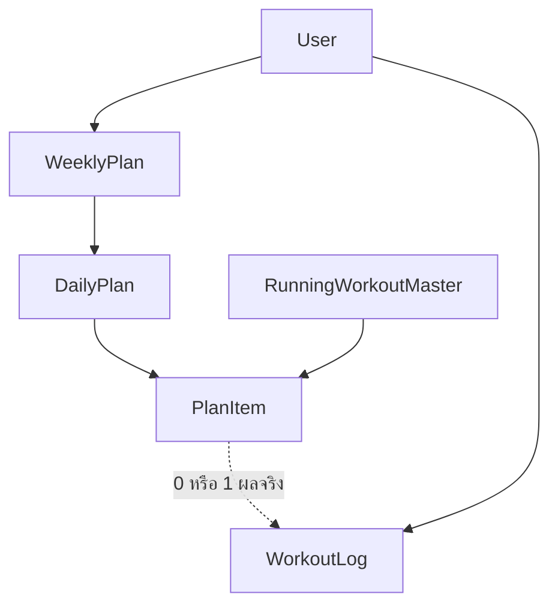
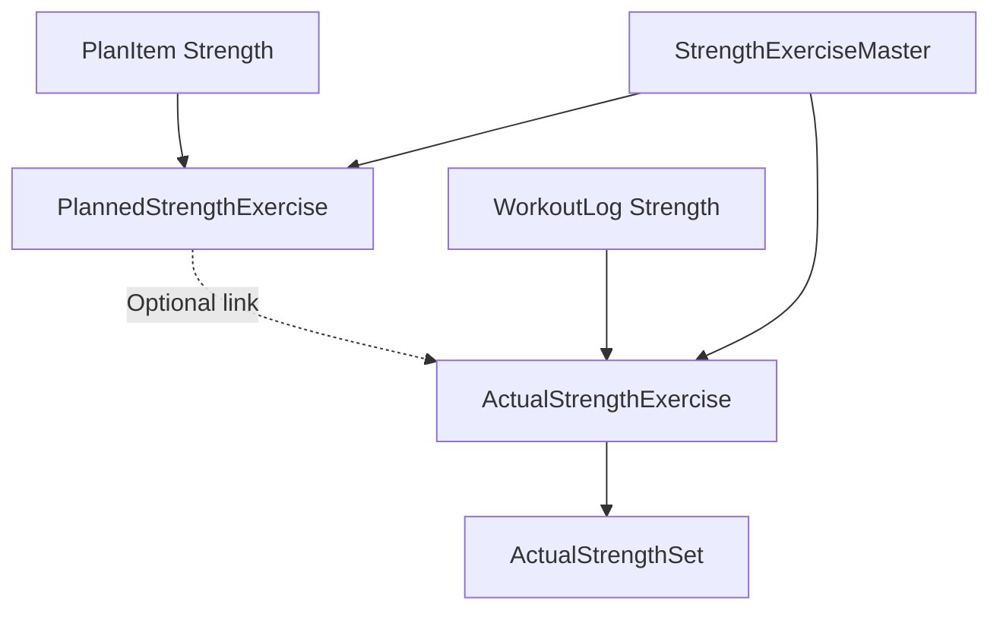

# Modern Running Journal Specification

เว็บแอปบันทึกและจัดแผนซ้อมวิ่งสำหรับผู้ใช้ที่กำหนดตารางเอง รองรับเป้าหมาย 5K, 10K, 21K และ 42K รวมการวิ่งและ Strength Training ในสัปดาห์เดียวกัน ใช้ Next.js กับ TypeScript และออกแบบ Mobile First ตั้งแต่โครงสร้างหน้าจอ

เอกสารนี้เป็นข้อกำหนดสำหรับ Codex ตั้งแต่ UX และ Visual Design ไปจนถึง Data Model, Business Rules, Acceptance Criteria และลำดับพัฒนา เวอร์ชันแรกต้องใช้งานและบันทึกข้อมูลจริงได้ ชื่อผลิตภัณฑ์ที่แสดงใน UI ใช้ “Running Journal” เป็นชื่อชั่วคราว

เวอร์ชัน 1.0 วันที่ 9 ตุลาคม 2026

## 1 เป้าหมายและขอบเขตผลิตภัณฑ์

ผู้ใช้ต้องทำวงจรนี้ได้ครบ: ตั้งเป้าหมาย → วางแผนแต่ละสัปดาห์ → บันทึกสิ่งที่ทำจริง → อ่านประวัติและดูความต่อเนื่อง → ปรับแผนสัปดาห์ถัดไป

ประสบการณ์หลักคือสมุดซ้อมส่วนตัวที่เปิดแล้วเข้าใจทันทีว่า “วันนี้ซ้อมอะไร สัปดาห์นี้ทำไปแค่ไหน และกำลังเตรียมตัวเพื่อเป้าหมายไหน” ผู้ใช้เลือกประเภทซ้อม ระยะทาง เวลา ท่าเวท และวันซ้อมด้วยตนเอง ระบบไม่สร้างหรือเปลี่ยนโปรแกรมซ้อมให้อัตโนมัติ

### ขอบเขตเวอร์ชันแรก

- สมัครและเข้าสู่ระบบด้วยอีเมลและรหัสผ่าน มีข้อมูลแยกตามผู้ใช้
- Home, Weekly Planner, Journal, Goals, Progress และ Settings
- สร้างแผนรายสัปดาห์และเพิ่มหลายเซสชันในวันเดียว เช่น Easy Run ตอนเช้าและ Strength ตอนเย็น
- เพิ่ม แก้ไข ย้ายวัน จัดลำดับ ทำสำเนา ข้าม และลบรายการซ้อมที่ยังไม่มีผลจริง
- ตั้งวันพักอย่างชัดเจน แยกจากวันที่ยังไม่ได้วางแผน
- คัดลอกสัปดาห์ก่อนหน้า และบันทึกสัปดาห์เป็นเทมเพลตส่วนตัว
- บันทึก Running และ Strength ทั้งจากแผนและนอกแผน
- เป้าหมายระยะทางและงานแข่งหลายรายการ เลือกเป้าหมายหลักได้หนึ่งรายการ
- สถิติจากข้อมูลจริงและการเปรียบเทียบแผนกับผลจริง
- Export ข้อมูลส่วนตัวเป็น JSON ที่มี schemaVersion
- Seed Master Data ตามรายการในเอกสาร พร้อมข้อมูลสาธิตที่เปิดใช้แยกจากบัญชีจริง

### ขอบเขตหลังเวอร์ชันแรก

Garmin/Strava integration, GPS tracking, แผนซ้อมที่สร้างด้วย AI, Social feed, Training readiness, การประเมินความเสี่ยงบาดเจ็บ, Race predictor, Push notification, Offline sync, รูปภาพใน Journal, Cross Training, Shoe mileage และ Personal Best จากผลแข่ง

เวอร์ชันแรกเป็นเว็บ Responsive ที่ใช้ผ่านมือถือได้ดี ยังไม่ต้องทำ Service Worker หรืออ้างว่าบันทึกข้อมูลแบบ Offline ได้

## 2 แนวทางดีไซน์

### บุคลิกและองค์ประกอบหลัก

ใช้สไตล์ Editorial Sports Journal: เรียบ มีจังหวะ ตัวเลขชัด และมีรายละเอียดที่ทำให้รู้สึกเป็นผลิตภัณฑ์สำหรับนักวิ่ง พื้นผิวสีอุ่นเหมือนกระดาษ ผสมสีเข้มและสีเขียวหม่น หน้าต่าง ๆ ไม่ควรประกอบด้วยกริดการ์ดขนาดเท่ากันทั้งหมด

ความโดดเด่นมาจาก Today session, ตัวเลขระยะทาง, แถบสัปดาห์, เครื่องหมายสถานะ และรูปแบบ Journal ที่มีเอกลักษณ์ ไม่ต้องอาศัยเอฟเฟกต์จำนวนมาก

| องค์ประกอบ | ข้อกำหนด |
| --- | --- |
| พื้นหลัก | สี Ivory `#F6F4EE` |
| พื้นส่วนอ่านข้อมูล | สีขาวอุ่น `#FFFEFA` |
| ตัวอักษรหลัก | Charcoal `#20251F` |
| ตัวอักษรรอง | `#62695F` ตรวจ Contrast บนพื้นจริง |
| สีหลัก | Forest `#2F4A3C` |
| Accent | Lime `#D7E88B` ใช้คู่ตัวอักษรเข้ม |
| เส้นแบ่ง | `#DDDCD2` |
| Quality workout | พื้น Clay อ่อน `#F2E0D5` และข้อความเข้ม |
| Strength | พื้น Slate อ่อน `#E4E8EB` และข้อความเข้ม |
| ฟอนต์ | Geist สำหรับอังกฤษและตัวเลข และ Noto Sans Thai สำหรับไทย ใช้ฟอนต์ที่มีสิทธิ์ใช้งานและเก็บวิธีโหลดในโปรเจกต์ |
| ตัวเลข | Tabular numerals เพื่อให้ระยะทาง เวลา และ Pace ไม่กระโดดเวลาเปลี่ยนค่า |
| มุมโค้ง | การ์ดเด่น 20–24 px ปุ่ม 12–14 px ส่วนลิสต์ใช้เส้นแบ่งและพื้นที่ว่าง |
| Shadow | ใช้เฉพาะส่วนลอย เช่น Sheet, Menu และ Drag overlay |
| ไอคอน | Lucide ชุดเดียว น้ำหนักเส้นและขนาดสม่ำเสมอ |
| ระยะห่าง | ใช้สเกล 4, 8, 12, 16, 24, 32, 48 px |

สีที่กำหนดเป็น Design Tokens เริ่มต้น ต้องตรวจ Contrast กับขนาดตัวอักษรจริงก่อนส่งงาน โดยเฉพาะข้อความรองและข้อความบนสีประเภทซ้อม

### ลำดับตัวอักษร

- ตัวเลขเด่นบน Home: 52–64 px ในมือถือ พร้อมหน่วย 16–18 px
- Heading หน้าหลัก: 28–32 px ในมือถือ และ 36–44 px ในเดสก์ท็อป
- Body: 15–16 px ฟอร์ม Input บนมือถือใช้ไม่น้อยกว่า 16 px
- Label: 12–13 px ใช้ Uppercase เฉพาะคำอังกฤษสั้น ๆ
- ชื่อประเภทซ้อมอังกฤษใช้เป็นชื่อเด่น เช่น “Easy Run” คำอธิบายและปุ่มใช้ภาษาไทยที่สม่ำเสมอ

### องค์ประกอบที่ทำให้ UI มีเอกลักษณ์

1. Today session ใช้ตัวเลขใหญ่และเส้นทางโค้งบาง ๆ แบบ SVG ที่เป็นลายตกแต่ง ระบุว่าเป็นกราฟิก ไม่สื่อว่าเป็นเส้นทาง GPS จริง
2. Week strip เป็นแถวเจ็ดวันพร้อมวันที่และเครื่องหมายแผนกับผลจริง ใช้ชุดเดียวกันบน Home และ Planner
3. Journal ใช้แถววันที่ ชื่อเซสชัน ระยะทางและ Pace แบบตัวเลขจัดแนว พร้อมข้อความบันทึกสั้น ๆ
4. Goal ใช้แถบระยะทางและวันแข่งขัน เช่น “21K” เป็นตัวเลขหลัก แต่ Countdown ต้องระบุว่าคือจำนวนวันที่เหลือ ไม่ใช่คะแนนความพร้อม
5. กราฟใช้เส้นหรือแท่งเรียบ จำกัดสี และมีตัวเลขหรือ Table view อ่านข้อมูลได้

ไม่ใช้ Gradient ม่วงน้ำเงิน, Glassmorphism เต็มหน้า, Emoji เป็นไอคอนหลัก, การ์ดเรืองแสง, ก้อนสถิติขนาดเท่ากันทุกจุด หรือข้อความสร้างแรงบันดาลใจยาว ๆ เป็นองค์ประกอบหลักของ UI

### Motion

- เปลี่ยนสถานะและเปิด Sheet ประมาณ 160–220 ms
- Drag overlay ยกขึ้นเล็กน้อย ไม่หมุนหรือขยายมาก
- Progress เปลี่ยนค่าด้วย Transition สั้น ไม่เล่น Animation ใหม่ทุกครั้งที่เข้าหน้า
- เคารพ `prefers-reduced-motion`
- ไม่มี Parallax หรือ Background animation ที่รบกวนการอ่านและการเลื่อน

## 3 เมนูและโครงสร้างหน้าจอ

| เมนู | Route | หน้าที่ |
| --- | --- | --- |
| วันนี้ | `/` | เซสชันวันนี้ เป้าหมายหลัก ภาพรวมสัปดาห์ และทางลัดบันทึก |
| แผนซ้อม | `/plan` | จัดแผนรายสัปดาห์ ย้ายวัน และใช้เทมเพลต |
| บันทึก | `/journal` | ประวัติผลซ้อมจริง ค้นหา กรอง และแก้ไข |
| เป้าหมาย | `/goals` | เป้าหมาย 5K, 10K, 21K, 42K และงานแข่งขัน |
| สถิติ | `/progress` | ระยะสะสม ความต่อเนื่อง และแผนเทียบผลจริง |
| ตั้งค่า | `/settings` | โปรไฟล์ Timezone และ Export เข้าจาก Avatar |
| รายละเอียดผลซ้อม | `/journal/[id]` | รายละเอียดและผลเทียบแผนของเซสชันเดียว |
| รายละเอียดเป้าหมาย | `/goals/[id]` | รายละเอียดเป้าหมายและผลแข่งที่ผู้ใช้เชื่อมเอง |

บนมือถือใช้ Bottom Navigation ห้าเมนูแรกพร้อม Label ไม่ซ่อนชื่อไว้หลังไอคอน Avatar อยู่ใน Header ไม่เพิ่ม Settings เป็นเมนูที่หก

บนเดสก์ท็อปใช้แถบนำทางด้านข้างแบบกระชับและพื้นที่เนื้อหากว้างขึ้น ไม่ขยาย Bottom Navigation เป็นแถบลอยกลางหน้าจอ

ปุ่ม “บันทึกการซ้อม” เป็น Primary action ตามบริบท เปิด Form แบบ Sheet ในมือถือ และ Dialog หรือแผงข้างในเดสก์ท็อป ไม่ต้องเพิ่ม FAB ลอยทับปุ่มบนทุกหน้า

## 4 ข้อกำหนดหน้า Home

### ลำดับเนื้อหาในมือถือ

| ลำดับ | ส่วน | เนื้อหาและการกระทำ |
| --- | --- | --- |
| 1 | Header | วันและวันที่ คำทักทายสั้น Avatar |
| 2 | Today session | ประเภทซ้อม เป้าหมายหลัก รายละเอียด และปุ่มบันทึก |
| 3 | Week strip | เจ็ดวัน แสดง Today, Planned, Logged และ Rest กดไปยังวันนั้นใน Planner |
| 4 | This week | ระยะวิ่งจริงเทียบแผน จำนวนเซสชันที่ทำสำเร็จ และ Strength sessions |
| 5 | Primary goal | ระยะเป้าหมาย ชื่องาน วันแข่งถ้ามี และ Countdown |
| 6 | Latest journal | ผลซ้อมล่าสุดไม่เกินสามรายการ พร้อมลิงก์ดูทั้งหมด |

ที่ขนาด 390 × 844 ส่วน Header, Today session และอย่างน้อยหัวแถบสัปดาห์ต้องมองเห็นได้โดยไม่เลื่อน ตัวเลขการซ้อมและ CTA ต้องเด่นกว่าข้อความตกแต่ง

### พฤติกรรม Today session

- มีหนึ่งเซสชัน: แสดงเซสชันนั้นเป็น Hero
- มีหลายเซสชัน: แสดงเซสชันที่ยังไม่บันทึกตามลำดับ พร้อมข้อความ “วันนี้ 2 เซสชัน” และรายการอื่นแบบแถวกระชับ
- ทำครบแล้ว: แสดงสรุปผลจริงและปุ่ม “ดูบันทึกวันนี้”
- วันพัก: แสดง “วันพัก” และหมายเหตุจากแผน มีปุ่ม “บันทึกนอกแผน” เป็น Secondary action
- ยังไม่วางแผน: แสดง “วันนี้ยังไม่มีแผน” พร้อม “เพิ่มแผน” และ “บันทึกนอกแผน”
- เป้าหมายแบบเวลา: แสดงนาทีเป็นตัวเลขหลัก ไม่เติมระยะทางสมมติ
- เซสชันแบบ Interval: แสดง “5 × 800 m” เป็นตัวเลขหลัก พร้อมรายละเอียดช่วงพัก
- หากกำหนดเวลาซ้อมไว้ ให้แสดงเวลานั้น เวลาใน MVP เป็น Label ไม่ใช่ Reminder

### ภาพรวมสัปดาห์

ตัวอย่าง “วิ่งแล้ว 18.4 km / วางแผน 30 km”, “สำเร็จ 3 / 5 เซสชัน”, “Strength 1 ครั้ง” เป็นข้อมูลจากสัปดาห์เดียวกัน ห้ามใช้ค่าจาก Mock เมื่อบัญชีนั้นมีข้อมูลจริง

หากแผนมีระยะทางไม่ครบเพราะบางเซสชันกำหนดเป็นนาที ให้แสดง “แผนระยะทางที่ระบุ 24 km + 1 เซสชันแบบเวลา” ไม่ทำให้ดูเหมือนระยะรวมทั้งสัปดาห์เป็น 24 km แน่นอน

บนเดสก์ท็อปใช้ Today session เป็นพื้นที่เด่นราวสองในสามของแถวแรก และ Goal เป็นคอลัมน์รอง แถวถัดไปจัด Week strip และ Journal ให้มีจังหวะเหมือนหน้าสมุดซ้อม

## 5 ข้อกำหนด Weekly Planner

### โครงหน้าจอ

- สัปดาห์เริ่มวันจันทร์ถึงอาทิตย์
- Header มีช่วงวันที่ ปุ่มสัปดาห์ก่อนและถัดไป และ “กลับสัปดาห์นี้”
- Week summary แสดงระยะที่วางแผน จำนวน Running sessions และ Strength sessions
- ปุ่มหลัก “เพิ่มการซ้อม” และเมนู “คัดลอกสัปดาห์” / “บันทึกเป็นเทมเพลต”
- Master library มี Running workout types และท่า Strength แบ่งกลุ่ม
- วันหนึ่งมีหลาย PlanItem ได้ และจัดลำดับภายในวันได้

### Mobile

แสดง Agenda แนวตั้งครบเจ็ดวัน วันละหนึ่ง Section แถบเจ็ดวันด้านบนกดแล้วเลื่อนไปยังวันนั้น ปุ่มเพิ่มในแต่ละวันเปิด Library sheet โดยผูกวันที่นั้นไว้ก่อน

แต่ละเซสชันมีแถบสีเล็ก ชื่อ เป้าหมาย สถานะ และเมนูเพิ่มเติม ไม่บีบเจ็ดคอลัมน์ลงบนหน้าจอโทรศัพท์

### Desktop

ตั้งแต่ 1280 px ใช้ Week board เจ็ดคอลัมน์และ Library ด้านข้างเมื่อมีพื้นที่พอ ที่ความกว้างกลางใช้ Library แบบ Drawer และ Board ที่เลื่อนภายในได้ หรือใช้ Agenda โดยหน้าเว็บหลักต้องไม่ล้นแนวนอน

### การเพิ่ม Running

1. เลือกวันและประเภทซ้อม
2. โหลด Default เป็น Draft ที่ผู้ใช้แก้ได้
3. เลือกเป้าหมายหลัก ระยะทาง เวลา หรือ Structured workout
4. เพิ่มเวลาโดยประมาณ หมายเหตุ และ Intensity ถ้าต้องการ
5. บันทึก แล้วเห็นรายการในวันที่เลือกทันที

### การเพิ่ม Strength

1. สร้าง Strength session ในวันนั้น
2. เลือกหนึ่งหรือหลายท่าจาก Library
3. กำหนดเซ็ต จำนวนครั้งหรือวินาที การนับซ้ายขวา น้ำหนัก และช่วงพัก
4. จัดลำดับท่าและใส่หมายเหตุ
5. บันทึกเป็น PlanItem หนึ่งรายการที่มีท่าย่อยหลายรายการ

### Drag and Drop

- Desktop: ลากจาก Library เพื่อสร้าง Draft และลากเซสชันเดิมเพื่อย้ายวันหรือจัดลำดับ
- Mobile: ลากเฉพาะจาก Handle ไม่จับทั้งการ์ด เพื่อให้ผู้ใช้เลื่อนหน้าได้ตามปกติ
- ใช้ Activation delay เริ่มต้นประมาณ 250 ms และ Movement tolerance ที่เหมาะกับ Touch ตรวจจริงบนมือถือ
- มี Drag overlay, Drop indicator และ Auto scroll เฉพาะระหว่าง Drag
- มีเมนู “ย้ายไปวันอื่น” ที่เปิด Date picker และ “เลื่อนขึ้น / เลื่อนลง” เสมอ
- รองรับ Keyboard และ Screen reader announcement เช่น “ย้าย Easy Run ไปวันพุธ”
- จำกัด `touch-action: none` เฉพาะ Handle เมื่อใช้ Pointer sensor ไม่ตั้งกับ Agenda ทั้งหน้า
- ย้ายแล้ว Persist จริง อัปเดตแผน Home และสรุปสัปดาห์จากข้อมูลชุดเดียวกัน
- หาก Save ล้มเหลว คืนตำแหน่งเดิมและแสดง Retry
- เซสชันที่มีผลจริงแล้วไม่อนุญาตให้ Drag หรือย้ายแผนย้อนหลัง

### Copy และ Templates

- คัดลอกจากสัปดาห์ใดก็ได้ จับคู่ด้วยตำแหน่งวัน 0–6 ของสัปดาห์
- คัดลอกเป้าหมาย รายการท่า หมายเหตุ เวลา และวันพัก แต่ไม่คัดลอกผลจริง สถานะ Skipped หรือ ID เดิม
- ก่อนใช้ให้ Preview และเลือก “เพิ่มต่อจากแผนเดิม” หรือ “แทนที่แผนที่ยังไม่บันทึก”
- Merge กับวันพักต้องแสดง Conflict ให้เลือกว่าจะคงวันพักหรือเปลี่ยนเป็นวันซ้อม
- Replace ที่มีเซสชันผูกผลจริงต้องแจ้ง Conflict และไม่เปลี่ยนข้อมูลบางส่วน
- หนึ่ง Operation ต้องสำเร็จทั้งหมดหรือ Rollback ทั้งหมด
- เป้าหมายงานแข่งของสัปดาห์ปลายทางไม่ถูกเปลี่ยนตามต้นทางอัตโนมัติ
- Template เป็นสำเนาอิสระ การแก้สัปดาห์ต้นทางไม่เปลี่ยน Template หรือสัปดาห์อื่น

### วันพักและสถานะ

“ยังไม่มีแผน” กับ “วันพัก” ต้องต่างกัน วันพักไม่ใช่เซสชันวิ่งระยะ 0 km

ตั้งวันพักในวันที่มีแผนซ้อมต้องให้ผู้ใช้เลือกนำแผนที่ยังไม่บันทึกออกก่อน ถ้ามีเซสชันผูกผลจริงจะไม่ให้แทนแผนด้วยวันพัก

ผู้ใช้ยังบันทึกผลนอกแผนในวันพักได้ โดยคงแผนพักเดิมและแสดงว่ามีการซ้อมนอกแผน

| สถานะที่แสดง | เงื่อนไข |
| --- | --- |
| Planned | มีแผน ไม่มีผลจริง และยังไม่พ้นวันซ้อม |
| Completed | มีผลจริงที่ผู้ใช้ยืนยันว่าเสร็จ |
| Partial | มีผลจริงที่ผู้ใช้ระบุว่าทำบางส่วน |
| Skipped | ผู้ใช้กดข้าม พร้อมเหตุผลได้ |
| Missed | วันซ้อมผ่านไปแล้ว ไม่มีผลจริงและไม่ได้กดข้าม คำนวณตอนอ่าน |
| Rest | ตั้งเป็นวันพัก ไม่มี PlanItem ที่ยังใช้งาน |
| Unplanned | วันยังไม่ได้จัดแผน หรือเป็นผลจริงที่ไม่ผูก PlanItem ตามบริบท |

Missed ไม่ต้องมี Cron เปลี่ยนค่าในฐานข้อมูล และยังบันทึกย้อนหลังได้ การไม่ถึงระยะทางเป้าหมายไม่ทำให้ระบบเปลี่ยน Completed เป็น Partial เอง

## 6 ข้อกำหนดการบันทึกผลจริง

### Running log

Required: วันที่ซ้อม ประเภทซ้อม ระยะทางจริง และเวลาที่เคลื่อนไหวจริง

Optional: เวลาเริ่ม เวลารวมทั้งหมด Heart rate เฉลี่ย RPE 1–10 ความรู้สึก หมายเหตุ และผลแบบ Completed หรือ Partial

- ระยะทางรับเป็น km ใน UI เก็บเป็นเมตร
- เวลาใช้ Input ชั่วโมง นาที วินาที และเก็บเป็นวินาที
- Pace คำนวณจาก Moving time และระยะทาง ไม่บังคับกรอกเพิ่ม
- Elapsed time ถ้ากรอก ต้องไม่น้อยกว่า Moving time
- บันทึก Recovery แบบ Run Walk ได้ในประเภท RECOVERY_RUN
- บันทึกย้อนหลังและบันทึกนอกแผนได้
- Plan targets แสดงเป็น Reference เท่านั้น ช่องผลจริงต้องชัดว่าเป็น “ทำจริง”
- ปุ่ม “ใช้ค่าเป้าหมายเป็นผลจริง” ทำได้เมื่อผู้ใช้กดเองและตรวจค่าก่อน Save
- ไม่บันทึกผลจริงจาก Plan อัตโนมัติเมื่อกดเปิด Form หรือกด Completed

### Strength log

- เลือกท่าจากแผนหรือเพิ่มท่านอกแผนได้
- แสดงผลเป็นรายเซ็ต พร้อมครั้งหรือวินาที น้ำหนัก และข้าง
- ปุ่ม “ทำตามแผนเซ็ตนี้” ต้องเป็นการยืนยันของผู้ใช้
- ท่าข้างเดียวบันทึกซ้ายและขวาต่างกันได้ เช่น ซ้าย 10 ครั้ง ขวา 8 ครั้ง
- Plank เก็บวินาทีโดยไม่มีค่า Reps ปลอม
- น้ำหนักหมายถึงน้ำหนักภายนอกรวม เช่น ดัมเบลสองข้าง ข้างละ 5 kg เก็บ 10 kg และมี Label อธิบาย
- ค่า 0 kg หมายถึงไม่ใช้น้ำหนักภายนอก ส่วน null หมายถึงไม่ได้บันทึกน้ำหนัก
- ต้องมีอย่างน้อยหนึ่งท่าและหนึ่งเซ็ตที่มีผลจริงก่อน Save เป็น Strength log
- เวลาเซสชัน RPE ความรู้สึก และหมายเหตุเป็น Optional

### แผนเทียบผลจริง

รายละเอียดผลซ้อมแสดงสองชุดข้อมูล เช่น “แผน 8 km / จริง 6.8 km” และ “แผน 3 × 10 ต่อข้าง / จริงดูรายเซ็ต” ไม่แก้ Plan targets ให้เท่าผลจริง

หนึ่ง PlanItem ผูก Active WorkoutLog ได้สูงสุดหนึ่งรายการ แต่วันเดียวมีหลาย PlanItem หรือหลาย Log นอกแผนได้ ผลย่อยของ Interval หรือเวทอยู่ภายใน Log เดียว

ถ้าซ้อมจริงคนละวันกับแผน ให้คงวันแผนเดิมและเก็บวันที่จริงแยก เช่น “แผนวันจันทร์ ทำจริงวันอังคาร” การทำสำเร็จนับกับสัปดาห์แผนเดิม ระยะสะสมนับกับวันที่ทำจริง

## 7 ข้อกำหนด Journal

ค่าเริ่มต้นเป็น Timeline ตามวันที่ทำจริง เรียงใหม่ไปเก่า แต่ละวันรวมหลายเซสชันเป็นกลุ่ม มีมุมมอง Calendar สลับได้

แต่ละรายการแสดงชื่อประเภท ระยะทาง เวลา Pace หรือ Strength summary, RPE และข้อความบันทึกไม่เกินสองบรรทัด แสดง Badge “นอกแผน” เมื่อไม่เชื่อมแผน

Filters: ช่วงวันที่ Running หรือ Strength, ประเภทวิ่ง และผล Completed หรือ Partial ค้นหาจากชื่อและหมายเหตุ มี Pagination หรือ Load more ไม่โหลดประวัติทั้งหมดเข้าฝั่ง Client

เปิดรายละเอียดแล้วดู แก้ไข และลบผลจริงได้ ลบต้องถามใน UI เพราะมีผลต่อประวัติและสถิติ ลบ Log ที่ผูกแผนแล้วทำให้แผนกลับเป็น Planned หรือ Missed ตามวัน โดยไม่ลบ PlanItem

Empty state แสดง “ยังไม่มีบันทึก” และปุ่มสร้างบันทึก ไม่มีตัวเลขสาธิตปะปนในบัญชีจริง

## 8 ข้อกำหนด Goals และ Progress

### Goals

| Field | พฤติกรรม |
| --- | --- |
| Distance | 5K, 10K, 21K หรือ 42K |
| Goal type | Finish หรือ Target time |
| Event name | Optional เช่น ชื่องานแข่ง |
| Event date | Optional ผู้ใช้ตั้งเป้าหมายโดยไม่มีงานแข่งได้ |
| Target time | Required เฉพาะ Target time |
| Primary | เป้าหมายหลัก Active ได้หนึ่งรายการ |
| Status | Active, Achieved หรือ Archived |
| Result log | ผู้ใช้เลือกเชื่อมกับ Running log ที่เป็น RACE_DAY ด้วยตนเอง |

ค่าระยะทางมาตรฐานของผลิตภัณฑ์: 5000, 10000, 21097.5 และ 42195 เมตร แสดง Label “21K” หรือ “42K” ได้ แต่ไม่สูญเสียระยะจริงเมื่อคำนวณ Pace เป้าหมาย

เป้าหมายแบบ Finish ไม่ต้องแสดง Pace เป้าหมาย งานแข่งที่ไม่มีวันที่ไม่แสดง Countdown วันที่งานผ่านแล้วแสดง “ผ่านมาแล้ว” และไม่เปลี่ยนเป็น Achieved เอง

เมื่อ Archive หรือ Mark achieved เป้าหมายหลัก ให้คืน isPrimary เป็น false ใน Transaction เดียวกัน ผู้ใช้เลือกเป้าหมายหลักใหม่เอง หากลบ Result log ให้ล้างการเชื่อมผล แต่คง Status ของ Goal ที่ผู้ใช้กำหนดไว้

Target pace = targetTimeSec / (distanceM / 1000) เป็นค่าเป้าหมายของผู้ใช้ ไม่มีข้อความรับรองว่าพร้อมทำเวลาได้ ไม่ตีความความก้าวหน้าจากระยะสะสมเป็นเปอร์เซ็นต์ความพร้อมแข่งขัน

### Progress

เลือกสัปดาห์ เดือน หรือช่วงวันที่ แสดง:

- ระยะวิ่งสะสมจาก Log จริง
- เวลาวิ่งรวมจาก Moving time
- จำนวน Running sessions และ Strength sessions
- จำนวนวันที่มีผลซ้อมอย่างน้อยหนึ่งรายการ
- กราฟระยะทางรายสัปดาห์ 8–12 สัปดาห์
- แผนระยะทางที่ระบุเทียบผลจริง พร้อมบอกแผนที่ระยะไม่ครบ
- สัดส่วน Completed, Partial, Skipped และ Missed ของแผน

ไม่แสดง “Avg pace ดีขึ้น” จากการเทียบ Easy กับ Interval โดยไม่มีบริบท กราฟ Pace ถ้ามี ต้องแสดงประเภทและใช้ Moving time รวมตามสูตรในหัวข้อ 14

## 9 Master Data และการปรับโครงสร้างเดิม

ข้อมูลต้นทางแบ่ง “ชนิดกิจกรรม” และ “วัตถุประสงค์การซ้อม” ปะปนกัน จึงแยกเป็นสอง Field:

- activityType: RUNNING, STRENGTH, REST โดย CROSS_TRAINING สงวนไว้สำหรับระยะถัดไป
- purpose: RECOVERY, AEROBIC_BASE, ENDURANCE, QUALITY_SPEED, POWER_FORM, NEUROMUSCULAR, COMPETITION

ช่วง Zone ต้องรองรับหลาย Zone ส่วน Target pace และ Effort เป็นคนละชนิดกับ HR Zone จึงไม่เก็บไว้ใน Field เดียวกัน

Default ทุกชุดเป็นตัวอย่างเริ่มต้นจาก Master Data ของผู้ใช้ ผู้ใช้แก้ได้ ไม่ใช่คำแนะนำที่ระบบปรับตามสุขภาพหรือความสามารถ และไม่ต้องเก็บข้อความที่อ้างว่าท่าใดป้องกันอาการบาดเจ็บได้แน่นอน

### Running workout master

| Code | ชื่อ TH และ EN | Activity | Purpose | Guidance | Default ที่นำเข้า Form |
| --- | --- | --- | --- | --- | --- |
| REST | วันพักผ่อน / Rest Day | REST | RECOVERY | ไม่ระบุ Zone | ตั้งวันพักและเพิ่มหมายเหตุได้ |
| RECOVERY_RUN | วิ่งฟื้นฟู / Recovery Run Walk | RUNNING | AEROBIC_BASE | Z1–Z2 | 4 km จากช่วงตัวอย่าง 3–5 km |
| EASY_RUN | วิ่งสบายสร้างฐาน / Easy Run | RUNNING | AEROBIC_BASE | Z2 | 6 km จากช่วงตัวอย่าง 5–8 km |
| LONG_RUN | วิ่งยาว / Long Run LSD | RUNNING | ENDURANCE | Z2 | 16 km จากช่วงตัวอย่าง 12–21 km |
| TEMPO | วิ่งเทมโป / Tempo Threshold | RUNNING | QUALITY_SPEED | ปลาย Z3–Z4 เป็นข้อความ Guidance | Warm up 2 km + Work 5 km + Cool down 2 km |
| INTERVAL | ซ้อมสปีด / Interval VO2 Max | RUNNING | QUALITY_SPEED | Z4–Z5 | 5 × 800 m พัก Jog 120 วินาทีระหว่างรอบ |
| FARTLEK | วิ่งเล่นความเร็ว / Fartlek | RUNNING | QUALITY_SPEED | Z2–Z4 | 10 รอบ เร็ว 60 วินาที + ช้า 120 วินาที รวม 30 นาที |
| HILL_REPEAT | วิ่งขึ้นเนิน / Hill Repeats | RUNNING | POWER_FORM | Z4–Z5 | 6 × 150 m ช่วงกลับลงเป็น Open recovery |
| STRIDES | เร่งลอยตัวสั้น / Strides | RUNNING | NEUROMUSCULAR | ใช้ Effort label ไม่มี HR Zone บังคับ | 4 × 80 m ช่วงพักเป็น Open recovery |
| RACE_DAY | วันแข่งขัน / Race Day | RUNNING | COMPETITION | Pace จากเป้าหมายเมื่อผู้ใช้เลือก | ระยะจาก Goal ที่เลือก ไม่มีค่า 21K ตายตัว |

Guidance จาก Master ไม่ใช่ BPM เป้าหมายส่วนบุคคล เวอร์ชันแรกไม่คำนวณ Zone จากอายุ Strides ไม่แปลงคำว่า Max Effort เป็น HR Zone 5 และ Race pace ไม่ถือว่าเป็น Zone

REST อยู่ใน Library เพื่อให้เลือกสะดวก แต่ Action นี้ตั้ง DailyPlan.isRestDay ไม่สร้าง PlanItem ประเภท RUNNING

### Strength exercise master

เก็บ Code ทั้ง 14 รายการให้ตรงกับต้นทาง ใช้ค่า Default แบบจำนวนเดียวใน Form และเก็บช่วงตัวอย่างไว้เป็น Hint

| Code | nameTh | nameEn |
| --- | --- | --- |
| BULGARIAN_SPLIT_SQUAT | บัลแกเรียนสปลิตสควอต | Bulgarian Split Squat |
| SL_RDL | โรมาเนียนเดดลิฟต์ขาเดียว | Single Leg Romanian Deadlift |
| WALKING_LUNGES | เดินลันจ์ | Walking Lunges |
| STEP_UPS | ก้าวขึ้นแท่นพร้อมยกเข่า | Step Ups with Knee Drive |
| GLUTE_BRIDGE | ยกสะโพก | Glute Bridge |
| CLAMSHELL | เปิดเข่าด้านข้าง | Clamshell |
| LATERAL_BAND_WALK | เดินด้านข้างด้วยยางยืด | Lateral Band Walk |
| STANDING_CALF_RAISE | ยืนเขย่งน่อง | Standing Calf Raise |
| SEATED_CALF_RAISE | ยกน่องแบบนั่งหรืองอเข่า | Seated Calf Raise |
| TIBIALIS_RAISE | ยกปลายเท้าบริหารหน้าแข้ง | Tibialis Raise |
| PLANK | แพลงก์ | Forearm Plank |
| SIDE_PLANK | แพลงก์ด้านข้าง | Side Plank |
| DEAD_BUG | เดดบัก | Dead Bug |
| BIRD_DOG | เบิร์ดด็อก | Bird Dog |

| Code | Muscle group | Default ต่อเซ็ต | Count mode | หมายเหตุ |
| --- | --- | --- | --- | --- |
| BULGARIAN_SPLIT_SQUAT | SINGLE_LEG | 3 เซ็ต × 10 ครั้ง | PER_SIDE | Hint 8–10 ครั้งต่อข้าง |
| SL_RDL | SINGLE_LEG | 3 × 12 ครั้ง | PER_SIDE | Hint 10–12 ครั้งต่อข้าง |
| WALKING_LUNGES | SINGLE_LEG | 3 × 20 ก้าวรวม | TOTAL_ALTERNATING | เท่ากับประมาณข้างละ 10 ก้าว ไม่เก็บเป็น 20 ต่อข้าง |
| STEP_UPS | SINGLE_LEG | 3 × 12 ครั้ง | PER_SIDE | Hint 10–12 ครั้งต่อข้าง |
| GLUTE_BRIDGE | GLUTES_HIPS | 3 × 15 ครั้ง | TOTAL | Default BILATERAL เลือก SINGLE_LEG ได้ ใช้ 10 ต่อข้างเป็น Draft |
| CLAMSHELL | GLUTES_HIPS | 3 × 20 ครั้ง | PER_SIDE | Hint 15–20 ครั้งต่อข้าง เลือกแบบมียางได้ |
| LATERAL_BAND_WALK | GLUTES_HIPS | 3 × 15 ก้าวต่อทิศทาง | PER_DIRECTION | ไป 15 กลับ 15 รวม 30 ต่อเซ็ต แสดงให้ชัด |
| STANDING_CALF_RAISE | CALVES_ANKLES | 3 × 20 ครั้ง | TOTAL | Hint 15–20 ครั้ง |
| SEATED_CALF_RAISE | CALVES_ANKLES | 3 × 15 ครั้ง | TOTAL | ระบุชื่อ Seated หรือ Bent Knee ในคำอธิบาย |
| TIBIALIS_RAISE | CALVES_ANKLES | 3 × 20 ครั้ง | TOTAL | น้ำหนักภายนอกไม่บังคับ |
| PLANK | CORE | 3 × 45 วินาที | TOTAL | Hint 45–60 วินาที ไม่มี Reps |
| SIDE_PLANK | CORE | 3 × 30 วินาที | PER_SIDE | Hint 30–45 วินาทีต่อข้าง |
| DEAD_BUG | CORE | 3 × 12 ครั้งรวมสลับข้าง | TOTAL_ALTERNATING | ไม่เก็บ 12 ต่อข้าง |
| BIRD_DOG | CORE | 3 × 10 ครั้ง | PER_SIDE | ข้างซ้ายและขวาแยกได้ |

isUnilateral เก็บเป็นคุณสมบัติของท่า แต่ยังต้องมี countMode เพราะ “ทำสลับข้างรวม 20 ครั้ง” ต่างจาก “20 ครั้งต่อข้าง” ชื่อท่าไทยและอังกฤษต้องมีครบใน Seed พร้อม Description ที่อธิบายการใช้งาน ไม่เพิ่มคำกล่าวอ้างทางการแพทย์

## 10 Data Model

### ความสัมพันธ์แผนกับผลจริง



### ความสัมพันธ์ Strength



WeeklyPlan → DailyPlan → PlanItem เป็นความสัมพันธ์หนึ่งต่อหลายตามลำดับ ส่วน PlannedStrengthExercise เป็นตารางเชื่อม PlanItem กับ StrengthExerciseMaster ที่มี Prescription และลำดับของตัวเอง ไม่ใช้เพียง Array ของ Exercise IDs

### ตารางหลัก

| Entity | Field หลัก | กฎ |
| --- | --- | --- |
| User และ Auth tables | ตาม Schema ของ Auth library | ใช้ Session และ Password hashing ของ Library |
| UserProfile | userId, displayName, timezone, locale | timezone เริ่ม Asia/Bangkok locale เริ่ม th-TH |
| RaceGoal | id, userId, distanceCode, distanceM, goalType, eventName, eventDate, targetTimeSec, isPrimary, status, resultWorkoutLogId | Target time ต้องเป็นบวก หนึ่ง Active primary ต่อผู้ใช้ |
| RunningWorkoutMaster | code, nameTh, nameEn, activityType, purpose, zoneMin, zoneMax, guidance, defaultTarget, seedVersion, isActive, sortOrder | Code เป็น Primary key ห้ามเปลี่ยนตามชื่อ |
| StrengthExerciseMaster | code, nameTh, nameEn, muscleGroup, isUnilateral, defaultPrescription, repLabel, guidance, seedVersion, isActive, sortOrder | defaultPrescription ผ่าน Schema validation |
| WeeklyPlan | id, userId, weekStartDate, goalId, title, note, revision | Unique userId กับ weekStartDate ต้องเป็นวันจันทร์ |
| DailyPlan | id, weeklyPlanId, date, isRestDay, note | สร้างครบ 7 วัน Unique weeklyPlanId กับ date |
| PlanItem | id, dailyPlanId, activityType, runningWorkoutCode, title, plannedStartTime, runningTarget, intensityTarget, note, sortOrder, planState, skipReason, masterSnapshot, deletedAt | RUNNING หรือ STRENGTH เท่านั้นใน MVP |
| PlannedStrengthExercise | id, planItemId, exerciseCode, variant, prescription, sortOrder, masterSnapshot | อนุญาตท่าเดิมซ้ำในเซสชันเพื่อรองรับ Circuit |
| WorkoutLog | id, userId, clientMutationId, planItemId, activityType, runningWorkoutCode, performedDate, startedAt, outcome, distanceM, movingDurationSec, elapsedDurationSec, sessionDurationSec, avgHeartRate, rpe, feeling, note, plannedSnapshot, masterSnapshot, deletedAt | ผูกแผนได้หรือเป็นนอกแผน หนึ่ง Active log ต่อ PlanItem |
| ActualStrengthExercise | id, workoutLogId, plannedExerciseId, exerciseCode, variant, countMode, sortOrder, masterSnapshot | ท่าที่เพิ่มนอกแผนมี plannedExerciseId เป็น null |
| ActualStrengthSet | id, actualExerciseId, setIndex, side, measurement, reps, durationSec, loadKg, note | Unique actualExerciseId กับ setIndex กับ side |
| PlanTemplate | id, userId, name, description, schemaVersion, payload | Payload เป็นต้นไม้ของวัน 0–6 และรายการ ไม่มี ID ผลจริง |

ตาราง Domain ใช้ UUID ส่วน userId ใช้ชนิดเดียวกับ Auth schema เช่น text ไม่สมมติว่า Auth library สร้าง UUID ทุกแบบ ตารางที่เปลี่ยนได้มี createdAt และ updatedAt เป็น timestamptz

PlanState เก็บเพียง SCHEDULED หรือ SKIPPED ส่วน Completed, Partial และ Missed คำนวณจากผลจริงและวัน ห้ามเก็บสถานะเดียวกันหลายตารางแล้วต้องคอย Sync

### Constraints และ Index

- Unique WeeklyPlan(userId, weekStartDate)
- Unique DailyPlan(weeklyPlanId, date)
- Partial unique RaceGoal(userId) เมื่อ status = ACTIVE และ isPrimary = true
- Partial unique WorkoutLog(planItemId) เมื่อ planItemId ไม่เป็น null และ deletedAt เป็น null
- Unique WorkoutLog(userId, clientMutationId) เพื่อคืนผลเดิมเมื่อ Retry Operation เดิม
- Index PlanItem(dailyPlanId, sortOrder) และ PlannedStrengthExercise(planItemId, sortOrder)
- Index WorkoutLog(userId, performedDate DESC) และ WorkoutLog(userId, activityType, performedDate)
- Unique ActualStrengthSet(actualExerciseId, setIndex, side)
- Foreign key ของ Master ใช้ Restrict และปิด isActive แทนลบ Master ที่มีประวัติ
- ไม่ Cascade การลบแผนไปลบผลจริง
- วันที่ DailyPlan ต้องอยู่ในสัปดาห์ของ Parent และวันพักห้ามมี Active PlanItem
- Log, Goal, Plan และ Exercise ที่เชื่อมกันต้องเป็นของผู้ใช้เดียวกัน ตรวจฝั่ง Server ภายใน Transaction
- ใช้ Decimal/Numeric สำหรับ distanceM และ loadKg เวลาเก็บเป็น Integer วินาที
- distanceM ต้องรองรับ 21097.5 เมตร ไม่ปัด Half marathon เป็น 21098 ตอนบันทึก

### Snapshot

PlanItem เก็บชื่อและ Guidance ของ Master ตอนสร้าง ผลจริงเก็บ Snapshot ของแผนตอนบันทึก และชื่อ Master ที่ใช้

การแก้ Master ในอนาคตไม่เปลี่ยนข้อความในประวัติเก่า การแก้ Template ไม่เปลี่ยนสัปดาห์ที่สร้างไปแล้ว การเปลี่ยน Goal ไม่แก้ระยะ Race Day ที่ผู้ใช้บันทึกไว้ก่อนหน้า

## 11 TypeScript Contracts

ตัวอย่างนี้กำหนด Domain contracts ให้ Codex นำไปสร้าง Zod schemas, Database schema และ Form DTO ต่อได้ ไม่ใช่ Schema ฐานข้อมูลสำเร็จรูป

```typescript
export type RunningWorkoutCode =
  | 'REST' | 'RECOVERY_RUN' | 'EASY_RUN' | 'LONG_RUN'
  | 'TEMPO' | 'INTERVAL' | 'FARTLEK' | 'HILL_REPEAT'
  | 'STRIDES' | 'RACE_DAY';

export type ActivityType =
  | 'RUNNING' | 'STRENGTH' | 'REST' | 'CROSS_TRAINING';

// ไม่ให้ REST หรือ CROSS_TRAINING กลายเป็น Session ใน MVP
export type SessionActivityType = 'RUNNING' | 'STRENGTH';

export type WorkoutPurpose =
  | 'RECOVERY' | 'AEROBIC_BASE' | 'ENDURANCE'
  | 'QUALITY_SPEED' | 'POWER_FORM' | 'NEUROMUSCULAR'
  | 'COMPETITION';

export type HeartRateZone = 1 | 2 | 3 | 4 | 5;

export type IntensityTarget =
  | { kind: 'NONE' }
  | { kind: 'HR_ZONE'; zoneMin: HeartRateZone; zoneMax: HeartRateZone }
  | { kind: 'PACE'; fastSecPerKm: number; slowSecPerKm: number }
  | { kind: 'EFFORT'; label: string };

export type StepTarget =
  | { kind: 'DISTANCE'; distanceM: number }
  | { kind: 'DURATION'; durationSec: number }
  | { kind: 'OPEN'; instruction: string };

export interface RunningStep {
  kind: 'STEP';
  phase: 'WARMUP' | 'WORK' | 'RECOVERY' | 'COOLDOWN' | 'STRIDES';
  target: StepTarget;
  intensity: IntensityTarget;
  note?: string;
}

export interface RunningRepeat {
  kind: 'REPEAT';
  repeatCount: number;
  steps: RunningStep[];
  // false ใช้เมื่อ Step สุดท้ายเป็น RECOVERY และไม่พักหลังรอบท้าย
  includeFinalRecovery: boolean;
}

export type RunningTarget =
  | { kind: 'DISTANCE'; distanceM: number }
  | { kind: 'DURATION'; durationSec: number }
  | {
      kind: 'STRUCTURED';
      steps: Array<RunningStep | RunningRepeat>;
      estimatedTotalDistanceM?: number;
    };

export interface RunningWorkoutMaster {
  code: RunningWorkoutCode;
  nameTh: string;
  nameEn: string;
  activityType: 'RUNNING' | 'REST';
  purpose: WorkoutPurpose;
  zoneMin?: HeartRateZone;
  zoneMax?: HeartRateZone;
  guidance: string;
  defaultTarget: RunningTarget | null; // REST และ RACE_DAY อาจเป็น null
  seedVersion: number;
  isActive: boolean;
}

export type MuscleGroup =
  | 'SINGLE_LEG' | 'GLUTES_HIPS' | 'CALVES_ANKLES' | 'CORE';

export type CountMode =
  | 'TOTAL' | 'PER_SIDE' | 'TOTAL_ALTERNATING' | 'PER_DIRECTION';

export type ExerciseDose =
  | { measurement: 'REPS'; reps: number; countMode: CountMode }
  | { measurement: 'TIME'; durationSec: number; countMode: 'TOTAL' | 'PER_SIDE' };

export type StrengthPrescription = ExerciseDose & {
  sets: number;
  loadKg: number | null;
  restSec?: number;
};

export interface StrengthExerciseMaster {
  code: string;
  nameTh: string;
  nameEn: string;
  muscleGroup: MuscleGroup;
  isUnilateral: boolean;
  repLabel: 'REPS' | 'STEPS';
  defaultVariant: string;
  defaultPrescription: StrengthPrescription;
  guidance: string;
  seedVersion: number;
  isActive: boolean;
}

export type SetSide =
  | 'BOTH' | 'LEFT' | 'RIGHT' | 'ALTERNATING' | 'OUTBOUND' | 'RETURN';

export type ActualSetValue =
  | { measurement: 'REPS'; reps: number }
  | { measurement: 'TIME'; durationSec: number };

export type ActualStrengthSetInput = ActualSetValue & {
  setIndex: number;
  side: SetSide;
  loadKg: number | null;
  note?: string;
};

export interface DailyPlanDTO {
  id: string;
  date: string; // YYYY-MM-DD ใช้ Date-only ไม่ใช่ UTC timestamp
  isRestDay: boolean;
  note?: string;
  items: PlanItemDTO[];
}

type PlanItemBase = {
  id: string;
  dailyPlanId: string;
  title: string;
  plannedStartTime?: string; // HH:mm ใน Timezone ผู้ใช้
  sortOrder: number;
  planState: 'SCHEDULED' | 'SKIPPED';
  note?: string;
};

export type PlanItemDTO = PlanItemBase & (
  | {
      activityType: 'RUNNING';
      runningWorkoutCode: Exclude<RunningWorkoutCode, 'REST'>;
      runningTarget: RunningTarget;
      intensityTarget: IntensityTarget;
    }
  | {
      activityType: 'STRENGTH';
      exercises: Array<{
        id: string;
        exerciseCode: string;
        variant: string;
        sortOrder: number;
        prescription: StrengthPrescription;
      }>;
    }
);
```

### Validation เพิ่มเติม

- ค่าระยะ เวลา จำนวนเซ็ต จำนวนครั้ง และ Repeat count ต้องมากกว่า 0
- RPE เป็น Integer 1–10 ส่วน loadKg เป็น null หรือค่าที่ไม่น้อยกว่า 0
- ค่า Measurement แบบ REPS ต้องไม่มี durationSec และแบบ TIME ต้องไม่มี reps
- Side ของผลจริงต้องตรงกับ Count mode: TOTAL ใช้ BOTH, PER_SIDE ใช้ LEFT และ RIGHT, TOTAL_ALTERNATING ใช้ ALTERNATING และ PER_DIRECTION ใช้ OUTBOUND และ RETURN หากทำได้เฉพาะบางข้างให้เก็บตามจริงและใช้ Outcome เป็น Partial ได้
- zoneMin ต้องไม่มากกว่า zoneMax และ fastSecPerKm ต้องไม่มากกว่า slowSecPerKm
- OPEN step ใช้สำหรับ Recovery ที่ไม่มีระยะหรือเวลาตายตัว
- REPEAT ไม่มี Nested repeat ใน MVP เพื่อลดความซับซ้อนของ Form
- includeFinalRecovery เป็น false ได้เฉพาะเมื่อ Step สุดท้ายเป็น RECOVERY
- ค่า Estimated distance ของ Structured workout เป็นระยะรวมโดยประมาณ ไม่ใช่ค่าที่เอาไปบวกกับ Step อีกครั้ง
- Form ส่ง Decimal และ Date-only ที่ Normalize แล้ว Server ตรวจซ้ำทุกครั้ง

## 12 ตัวอย่างแผนหนึ่งสัปดาห์

ข้อมูลต่อไปนี้เป็นตัวอย่างสำหรับ QA และสาธิตระบบ ไม่ใช่โปรแกรมซ้อมแนะนำให้ผู้ใช้ทุกคนทำตาม สัปดาห์เริ่ม 12 ตุลาคม 2026

| วัน | รายการ | เป้าหมาย |
| --- | --- | --- |
| จันทร์ | Rest | พัก |
| อังคาร | Easy Run และ Strength | วิ่ง 6 km ตามด้วย Strength คนละ PlanItem |
| พุธ | Interval | 5 × 800 m พัก 120 วินาทีระหว่างรอบ |
| พฤหัสบดี | Recovery Run Walk | 4 km |
| ศุกร์ | Strength | Core และ Calves |
| เสาร์ | Rest | พัก |
| อาทิตย์ | Long Run | 16 km |

แผนนี้มี Running 4 เซสชันและ Strength 2 เซสชัน ระยะจากช่วงวิ่งที่ระบุรวมอย่างน้อย 30 km ส่วนระยะช่วงพัก Jog ของ Interval ยังไม่ทราบ ห้ามแสดงเป็น “รวม 30 km” โดยไม่ระบุว่าระยะไม่ครบ

### ตัวอย่าง Structured interval

```json
{
  "activityType": "RUNNING",
  "runningWorkoutCode": "INTERVAL",
  "title": "5 × 800 m",
  "runningTarget": {
    "kind": "STRUCTURED",
    "steps": [
      {
        "kind": "REPEAT",
        "repeatCount": 5,
        "includeFinalRecovery": false,
        "steps": [
          {
            "kind": "STEP",
            "phase": "WORK",
            "target": { "kind": "DISTANCE", "distanceM": 800 },
            "intensity": { "kind": "NONE" }
          },
          {
            "kind": "STEP",
            "phase": "RECOVERY",
            "target": { "kind": "DURATION", "durationSec": 120 },
            "intensity": { "kind": "EFFORT", "label": "Jog recovery" }
          }
        ]
      }
    ]
  },
  "intensityTarget": { "kind": "NONE" }
}
```

ตัวอย่างนี้ Work distance = 4000 m และ Recovery time = 480 วินาที ไม่ใช่ 600 วินาที ไม่มีค่า Pace ส่วนบุคคลหรือระยะช่วงพักที่ระบบเดาเอง

### ตัวอย่าง Strength session

```json
{
  "activityType": "STRENGTH",
  "title": "Legs and core",
  "exercises": [
    {
      "exerciseCode": "BULGARIAN_SPLIT_SQUAT",
      "variant": "STANDARD",
      "sortOrder": 0,
      "prescription": {
        "measurement": "REPS",
        "sets": 3,
        "reps": 10,
        "countMode": "PER_SIDE",
        "loadKg": 0
      }
    },
    {
      "exerciseCode": "PLANK",
      "variant": "STANDARD",
      "sortOrder": 1,
      "prescription": {
        "measurement": "TIME",
        "sets": 3,
        "durationSec": 45,
        "countMode": "TOTAL",
        "loadKg": 0
      }
    }
  ]
}
```

เมื่อ Duplicate ต้องสร้าง PlanItem และ PlannedStrengthExercise IDs ใหม่ทั้งหมด ก่อน Persist ให้ Server เติม IDs และ Snapshot ไม่ใช้ JSON ตัวอย่างเป็น Entity ที่ผ่านการ Validate แล้วโดยอัตโนมัติ

## 13 Business Rules และความถูกต้องของข้อมูล

### วันที่และ Timezone

- WeeklyPlan.weekStartDate, DailyPlan.date, Goal.eventDate และ WorkoutLog.performedDate ใช้ SQL date
- createdAt, updatedAt และ startedAt ถ้ามี ใช้ timestamptz
- “วันนี้”, Missed, Countdown และขอบเขตสัปดาห์คำนวณตาม UserProfile.timezone
- เปลี่ยน Timezone ไม่ทำให้วันที่แผนและวันที่ซ้อมจริงที่ผู้ใช้กรอกไว้เลื่อนวัน
- ทดสอบเคส 00:30 เวลาไทย ซึ่งยังเป็นวันก่อนหน้าใน UTC
- Goal countdown เป็นผลต่างของวันในปฏิทิน ไม่ใช้การหาร Milliseconds ด้วย 24 ชั่วโมงโดยตรง

### การแก้ไขและลบ

- แผนที่ไม่มีผลจริงแก้และย้ายได้ รวมถึงแผนที่เป็น Missed
- PlanItem ที่ผูก Active log ล็อกวัน ประเภท และ Prescription เพื่อรักษาแผนเดิม แก้ได้เฉพาะหมายเหตุ
- หากต้องแก้โครงแผนหลังมีผลจริง ผู้ใช้ต้องลบผลจริงผ่าน UI ก่อน
- Skipped กลับเป็น SCHEDULED ได้ก่อนบันทึกจริง หรือบันทึกย้อนหลังเพื่อเปลี่ยนเป็น Completed หรือ Partial
- ลบ PlanItem ที่ไม่มีผลจริงเป็น Soft delete และมี Undo ชั่วคราว
- WorkoutLog ลบเป็น Soft delete ไม่นับในสถิติและไม่ยึด Unique slot ของแผน
- หลังลบ Log หากจะบันทึกใหม่ต้องสร้าง clientMutationId ใหม่ ส่วน Retry ด้วย ID เดิมคืนผล Operation เดิมและไม่ Restore ข้อมูลเอง
- Restore ต้องตรวจ Conflict ใหม่ เช่น มี Log ใหม่ผูก PlanItem เดิมแล้ว
- ห้ามลบสัปดาห์แล้วทำให้ WorkoutLog หายตาม

### Concurrency และ Optimistic UI

ทุกการเปลี่ยนแผนใช้ WeeklyPlan.revision เป็น Guard และอัปเดตภายใน Transaction ย้ายข้ามสัปดาห์ต้องตรวจ Revision ทั้งต้นทางและปลายทาง

Save, Edit และ Delete Log ที่ผูกแผนต้องล็อก PlanItem และสัปดาห์ที่เกี่ยวข้องด้วย เพื่อไม่ให้การย้ายหรือลบแผนแข่งกับการบันทึกผลจริง บันทึก Log ให้รายการ Skipped แล้วต้องคืน planState เป็น SCHEDULED ใน Transaction เดียวกัน

ล็อกแถวสัปดาห์ที่เกี่ยวข้องตามลำดับ ID เดียวกันเพื่อเลี่ยง Deadlock เมื่อ Drop สำเร็จ Server ส่งตำแหน่งและ Revision ล่าสุดกลับมา ถ้าข้อมูลถูกแก้จากอีก Tab ให้ Refetch และแจ้ง Conflict ไม่เขียนทับเงียบ ๆ

Optimistic UI ใช้เพื่อแสดงตำแหน่งทันที แต่ Save status ต้องชัด จนกว่า Server ตอบสำเร็จยังไม่แสดงว่าบันทึกเรียบร้อย

Save log ใช้ Client mutation ID ที่มี Unique constraint ต่อผู้ใช้ เพื่อให้ Double tap หรือ Retry ไม่สร้างผลซ้ำ รวมถึง Log นอกแผน

### Privacy

ทุก Query, Action และ Export ตรวจ Session จริงและ Ownership ฝั่ง Server ไม่ใช้เพียงการซ่อนปุ่มหรือการตรวจว่ามี Cookie ผู้ใช้ต้องอ่านหรือแก้ข้อมูลบัญชีอื่นไม่ได้จากการเปลี่ยน ID

ไม่ใส่ Notes, Password, Tokens หรือรายละเอียดสุขภาพใน Application logs ไม่ส่ง Journal ไป External analytics โดยค่าเริ่มต้น

Export ใช้ schemaVersion = 1 พร้อม exportedAt, profile, goals, weeklyPlans ที่รวมวันและรายการย่อย, workoutLogs ที่รวมท่าและเซ็ต และ templates รวม Archived goals แต่ไม่รวม Soft deleted records หรือ Auth tables เก็บ Master codes และ Snapshots ที่จำเป็นเพื่ออ่านประวัติได้โดยไม่พึ่ง Master ปัจจุบัน

## 14 นิยามสถิติ

| Metric | สูตรหรือกฎ |
| --- | --- |
| Actual running distance | ผลรวม distanceM ของ Active RUNNING logs ใน performedDate ที่เลือก รวม Partial และนอกแผน |
| Moving time | ผลรวม movingDurationSec ของ Active RUNNING logs |
| Average pace | ผลรวม movingDurationSec ÷ ผลรวมระยะ km ไม่ใช้ค่าเฉลี่ย Pace รายเซสชัน |
| Running sessions | จำนวน Active RUNNING logs ไม่ใช่จำนวน Running steps |
| Strength sessions | จำนวน Active STRENGTH logs ไม่ใช่จำนวนท่าหรือเซ็ต |
| Training days | จำนวน performedDate ที่ไม่ซ้ำและมี Active log อย่างน้อยหนึ่งรายการ |
| Plan completion | จำนวน PlanItem ที่มี Completed log ÷ จำนวน Active PlanItem ทั้งสัปดาห์ |
| Partial | แสดงแยก ไม่ให้คะแนน 0.5 เอง |
| Skipped และ Missed | ยังอยู่ในจำนวนแผนของสัปดาห์ |
| Rest | ไม่อยู่ในตัวหารเซสชัน และไม่เพิ่มระยะ 0 ในค่า Pace |
| Unplanned logs | เพิ่ม Actual distance และ Sessions แต่ไม่เพิ่มตัวตั้งของ Plan completion |
| ไม่มีแผนในสัปดาห์ | แสดง Completion เป็น “ยังไม่มีแผน” ไม่แสดง 0% หรือ 100% |
| มีแผนแต่ยังไม่มีผลจริง | Actual distance แสดง 0 ส่วน Average pace แสดงขีดและคำว่า “ยังไม่มีข้อมูล” |

### ระยะและเวลาของ Structured workout

คำนวณสองค่าแยกกันคือ knownDistanceM และ knownDurationSec พร้อม Flag ว่าเป็นยอดรวมครบหรือเพียงส่วนที่ระบุ

- DISTANCE step ไม่สมมติ Duration
- DURATION step ไม่สมมติ Distance
- OPEN recovery ไม่สมมติทั้งสองค่า
- Repeat ต้องเคารพ includeFinalRecovery
- ถ้า estimatedTotalDistanceM มีค่า ให้แสดงเป็น “ระยะประมาณ” และใช้แทนยอดระยะของเซสชัน ไม่บวกกับ knownDistanceM ซ้ำ
- หากมีเซสชันที่ระยะไม่ครบ ห้ามสร้าง Progress bar เทียบระยะที่ดูเหมือนเป็นเป้าหมายรวมแน่นอน
- ยอด Completion และยอดระยะใช้คนละฐานวันที่เมื่อมีการซ้อมข้ามวันแผน ต้องมี Label อธิบาย

ตัวอย่างทดสอบ Average pace: 5 km ใน 1800 วินาที และ 10 km ใน 4200 วินาที รวม 15 km ใน 6000 วินาที เท่ากับ 400 วินาทีต่อ km หรือ 6:40/km ไม่ใช่ 6:30/km

## 15 Technical Architecture

ใช้ Full stack Next.js สำหรับเวอร์ชันแรก แยก Domain services ออกจาก UI เพื่อให้เปลี่ยน Form หรือเพิ่ม Integration ได้โดยไม่ต้องเขียนกฎธุรกิจซ้ำ

| ส่วน | Stack และบทบาท |
| --- | --- |
| Framework | Next.js App Router และ TypeScript strict |
| Runtime | Node.js รุ่น Stable ที่เข้ากับ Dependencies และ Pin ไว้ |
| Styling | Tailwind CSS และ CSS custom properties สำหรับ Design Tokens |
| Components | shadcn/ui เป็น Primitive แล้วปรับ Style ตามสเปก ไม่ใช้ Default dashboard ทั้งชุด |
| Form | React Hook Form และ Zod |
| Database | PostgreSQL และ Drizzle ORM พร้อม Migration |
| Auth | Better Auth แบบ Email Password ใช้ PostgreSQL เดียวกัน |
| Interaction | dnd-kit รุ่น Stable ที่เลือกให้เข้ากับ React ตรวจ API ของรุ่นนั้นก่อน Implement |
| Charts | Recharts โหลดเฉพาะหน้าที่ใช้ พร้อมตารางข้อมูลหรือ Summary |
| Icons | Lucide |
| Date | Date-only helpers และ Library ที่รองรับ IANA Timezone |
| Tests | Vitest สำหรับ Domain logic และ Playwright สำหรับ Flow สำคัญ |

หากต่อยอด Repository ที่มีอยู่แล้ว ให้ใช้ Convention และ Packages เดิมเมื่อทำงานตามสเปกได้ ไม่ย้าย ORM หรือ Auth library โดยไม่มีเหตุผลในงานนี้ สำหรับโปรเจกต์ใหม่ให้ใช้ Stack ข้างต้น

เลือกเวอร์ชัน Stable ที่เข้ากันได้ขณะเริ่มพัฒนา เก็บ Lockfile และระบุเวอร์ชันที่ทดสอบแล้วใน README ไม่ใช้ Canary หรือ API ของอีก Major โดยเดาจากตัวอย่างเก่า

### โครงสร้างโปรเจกต์

| Path | หน้าที่ |
| --- | --- |
| src/app | Routes, Layouts, loading, error และ Auth handlers |
| src/components/ui | Primitive components |
| src/features/home | Today session และ Weekly summary |
| src/features/planner | Agenda, Week board, Library และ Plan forms |
| src/features/journal | Timeline, Calendar, Log forms และ Details |
| src/features/goals | Goal cards และ Forms |
| src/features/progress | Aggregations presentation และ Charts |
| src/lib/domain | Types, Validation, Rules และ Metric calculators |
| src/lib/services | Planner, Logging, Goal และ Export services |
| src/lib/auth | Auth configuration และ Session helpers |
| src/lib/db | Schema, Queries และ Connection |
| drizzle | SQL migrations |
| scripts | Seed และ Utilities |
| tests | Domain tests และ E2E |
| docs | สเปกและบันทึกการตัดสินใจที่จำเป็น |

Server Components ใช้สำหรับอ่านข้อมูลเริ่มต้น Client Components ใช้เฉพาะส่วนโต้ตอบ เช่น Forms, Drag และ Charts Server Actions เรียก Domain services เพื่อแก้ข้อมูล Route Handlers ใช้กับ Auth และ Export

Database และ Auth secrets ไม่เข้าฝั่ง Client ปรับ Cache ของข้อมูลส่วนตัวให้แยกผู้ใช้หรือไม่ Cache และ Revalidate ข้อมูลหน้าที่เกี่ยวข้องหลัง Mutation

เวอร์ชันแรกไม่ต้องแยก FastAPI, Redis, Background queue หรือ Microservice เพิ่ม

### Environment และการรัน

ต้องมี .env.example, DATABASE_URL, Auth secret และ Base URL ที่ Library รุ่นที่เลือกต้องการ รองรับ Database ภายในเครื่องหรือ PostgreSQL ที่มีอยู่แล้ว

มี Docker Compose สำหรับ PostgreSQL ใน Development ถ้าโปรเจกต์ยังไม่มี Database วิธีรัน Migration และ Seed ต้องชัดและไม่ Drop ฐานข้อมูลโดยอัตโนมัติ Seed master เป็น Idempotent ส่วน Demo seed เปิดใช้อย่างชัดเจนและใช้ฐานข้อมูลหรือบัญชีสาธิตที่แยกจากผู้ใช้จริง

README ต้องอธิบายติดตั้ง รัน Dev, Build, Start, Migrate, Seed, Test และสำรองฐานข้อมูลสำหรับ Self hosting

## 16 Service Contracts

Server Actions ไม่จำเป็นต้องมี REST endpoint ซ้ำสำหรับทุกการกระทำ แต่ต้องมี Service ที่แยกจาก React และตรวจข้อมูลตามกฎเดียวกัน

| Service | Input สำคัญ | ผลลัพธ์ |
| --- | --- | --- |
| getOrCreateWeek | weekStartDate | WeeklyPlan และ 7 DailyPlan โดยไม่สร้างซ้ำ |
| addPlanItem | date, validatedDraft, expectedRevision | PlanItem พร้อม ID และ Snapshot |
| updatePlanItem | planItemId, changes, expectedRevision | แผนล่าสุด หรือ Locked error |
| movePlanItem | planItemId, targetDate, targetIndex, sourceRevision, targetRevision | ตำแหน่งและ Revision ของสัปดาห์ที่เกี่ยวข้อง |
| reorderPlanItems | dailyPlanId, orderedIds, expectedRevision | Canonical order ตรวจ ID ให้ครบและไม่ซ้ำ |
| duplicatePlanItem | planItemId, targetDate, expectedRevision | รายการใหม่และ Exercise IDs ใหม่ |
| setRestDay | date, expectedRevision | วันพัก หรือ Conflict ถ้ามีแผน |
| skipPlanItem | planItemId, reason, expectedRevision | planState = SKIPPED |
| deletePlanItem | planItemId, expectedRevision | Soft delete สำหรับแผนที่ไม่มีผลจริง |
| copyWeek | sourceWeekId, targetWeekStartDate, mode, conflictChoices, expectedRevision | Deep copy ทั้งสัปดาห์แบบ Atomic |
| saveWeekTemplate | weekId, name, expectedRevision | Template snapshot ที่ไม่ผูกกับต้นทาง |
| applyTemplate | templateId, targetWeekStartDate, mode, expectedRevision | แผนใหม่ ไม่ย้ายผลจริง |
| saveWorkoutLog | clientMutationId, planItemId optional, actualData | Active log หนึ่งรายการ พร้อม Derived metrics |
| updateWorkoutLog | logId, actualData | ผลจริงล่าสุดและสถิติใหม่ |
| deleteWorkoutLog | logId | Soft delete และคืนสถานะแผนตามวันที่ |
| getJournal | filters, cursor | ผลจริงแบบ Paginated |
| getProgress | dateRange | Aggregates ตามนิยามหัวข้อ 14 |
| saveGoal | validatedGoal | Goal และ Primary state ที่ถูกต้อง |
| exportUserData | current session | JSON เฉพาะข้อมูลผู้ใช้ที่เข้าสู่ระบบ |

ทุก Service ใช้ userId จาก Session ไม่เชื่อค่าที่ Client ส่งมา Error ใช้รูปแบบสม่ำเสมอ เช่น VALIDATION, UNAUTHENTICATED, NOT_FOUND, CONFLICT และ LOCKED

## 17 Responsive Accessibility และสถานะหน้าจอ

### Layout

- ตรวจที่ 360, 390, 430, 768, 1280 และ 1440 px
- Content หลักบน Desktop Max width ประมาณ 1180 px Planner ขยายได้ถึง 1440 px
- Mobile padding 16–20 px ไม่มี Page overflow แนวนอน
- Bottom Navigation รองรับ safe-area-inset-bottom และเว้น Padding ให้เนื้อหาไม่ถูกทับ
- ปุ่มแตะอย่างน้อย 44 × 44 px เพิ่มพื้นที่ Handle สำหรับ Drag
- หัว Planner และ Week strip Sticky เฉพาะส่วนที่ช่วยการจัดแผน ไม่กินความสูงหน้าจอเกินจำเป็น
- Sheet ใช้พื้นที่ไม่เกินประมาณ 90dvh เลื่อน Form ภายในได้ Save button ไม่หายหลังคีย์บอร์ด
- ฟอร์มเลื่อน Field ที่กำลังกรอกให้เห็น ใช้ inputMode เหมาะกับระยะ น้ำหนัก และเวลา
- Dialog คืน Focus ไปปุ่มต้นทางเมื่อปิด และ Keyboard เข้าถึงทุก Action ได้
- วันที่ไทยใช้ปี ค.ศ. และหน่วย km, นาที, วินาที ตลอด MVP

### States

| State | พฤติกรรม |
| --- | --- |
| Loading | Skeleton ใกล้โครงจริง ไม่ทำให้ Layout กระโดดมาก |
| Saving | แสดง “กำลังบันทึก” ป้องกัน Double submit |
| Success | อัปเดตข้อมูลจริง พร้อม Feedback สั้น |
| Validation error | ใต้ Field และ Focus ไปจุดแรกที่ผิด |
| Network error | คงค่าที่กรอกไว้ พร้อม Retry |
| Conflict | แจ้งว่าข้อมูลเปลี่ยนแล้ว โหลดค่าล่าสุดก่อนแก้ต่อ |
| Empty | ข้อความตามบริบทและ CTA ที่ทำงานจริง |
| Offline | แจ้งว่าบันทึกไม่ได้ คง Draft ใน Form โดยไม่แสดง Success |
| Long content | ชื่อยาวและภาษาไทยหลายบรรทัดไม่ทับปุ่ม |
| Destructive action | Confirmation ในแอปก่อนลบผลจริง ไม่ใช้ Browser alert |

สถานะและประเภทซ้อมต้องมีชื่อหรือสัญลักษณ์ร่วมกับสี ไม่ใช้สีอย่างเดียว และข้อความบน Accent ต้องมี Contrast ที่อ่านได้

## 18 แผนพัฒนาและ Tickets

แต่ละ Phase ต้องส่ง Flow ที่ทำงานได้พร้อมทดสอบ จุดตรวจกลางทางใช้เพื่อประเมินงาน ไม่เป็นเหตุให้หยุดเมื่อยังทำงานในขอบเขตต่อได้

| Phase | Ticket | งานและเกณฑ์จบ |
| --- | --- | --- |
| 1 | T01 | Scaffold, Tokens, Typography, App shell และ Navigation ทั้ง Mobile/Desktop |
| 1 | T02 | Database migrations, Auth, UserProfile, Master seed และ Ownership checks |
| 1 | T03 | Vertical slice: เพิ่ม Easy Run → บันทึกผลจริง → เปิด Journal หลัง Reload |
| 1 | T04 | Home ครบ State มีหลายเซสชัน วันพัก ไม่มีแผน และทำครบ |
| 2 | T05 | WeeklyPlan, DailyPlan และ Running plan form ครบระยะ เวลา และ Structured steps |
| 2 | T06 | Strength library และ PlannedStrengthExercise พร้อม Reps/Time/Count mode |
| 2 | T07 | Move, Reorder, DnD, Keyboard, Date picker fallback และ Conflict rollback |
| 2 | T08 | Copy week, Rest conflicts และ Personal week templates |
| 3 | T09 | Running/Strength logs แบบครบและบางส่วน บันทึกนอกแผนและย้อนหลัง |
| 3 | T10 | Journal timeline, Calendar, Filter, Detail, Edit และ Delete |
| 3 | T11 | Goals ทั้งสี่ระยะ Primary goal และเชื่อมผล Race Day |
| 3 | T12 | Progress aggregates และ Charts ที่ใช้สูตรตรงกับ Home |
| 4 | T13 | Settings, JSON export, Empty/Error/Offline states และ Demo seed |
| 4 | T14 | Domain/E2E tests, Mobile QA, Production build และ README |

หลัง T04 ตรวจแนวดีไซน์จาก Screenshot ของ Home และ Planner shell ก่อนขยาย Component pattern ไปทั้งระบบ หากโครงดูเหมือน Dashboard template ให้แก้ Tokens, Typography และองค์ประกอบหลักใน Phase นี้

## 19 Acceptance Criteria

### Functional และ Data

- ผู้ใช้สร้างสัปดาห์ เพิ่มหลายเซสชันต่อวัน และตั้งวันพักได้
- ลากหรือกด Move แล้วข้อมูลยังอยู่ตำแหน่งใหม่หลัง Reload
- บนมือถือเลื่อนผ่านการ์ดได้โดยไม่เริ่ม Drag และย้ายวันได้แม้ไม่ใช้ Drag
- Running targets รองรับระยะ เวลา Tempo, Interval, Fartlek และ Open recovery
- มี Master 10 Running library codes รวม REST และ Strength exercises ครบ 14 Codes
- Strength แยกท่ารายเซสชัน เซ็ตรายผลจริง และผลซ้ายขวาได้
- Copy week สร้าง IDs ใหม่ทั้งหมดและไม่คัดลอกผลจริง
- เปลี่ยน Master หรือ Template ไม่ทำให้ประวัติเก่าเปลี่ยน
- Plan และ Actual ไม่ทับค่ากัน
- Log จากแผนซ้ำไม่ได้แม้กด Save สองครั้ง และ Log นอกแผน Retry ไม่สร้างซ้ำ
- ลบผลจริงแล้วสถิติและสถานะแผนอัปเดตถูกต้อง
- วันพักและแผนระยะไม่ครบไม่ทำให้สถิติผิด
- Goal ที่ไม่มีวันที่และไม่มี Target time ใช้งานได้ตามชนิดเป้าหมาย
- ข้อมูลบัญชี A ไม่ปรากฏในบัญชี B และเข้าถึงข้ามบัญชีด้วย ID ไม่ได้
- Export ครบแผน ผลจริง เป้าหมาย Templates และ Snapshot ที่จำเป็น ไม่มีข้อมูล Auth secrets

### Domain tests ที่ต้องมี

1. Week boundary และ Today ใน Asia/Bangkok รวมเคสก่อนเที่ยงคืน UTC
2. Copy week ข้ามเดือน ข้ามปี และไม่คัดลอก Log หรือ ID เดิม
3. REST conflict และ Atomic rollback เมื่อ Target week มี Log
4. ระยะและเวลาของ Repeat รวมการไม่พักหลังรอบสุดท้าย
5. Average pace แบบถ่วงด้วยระยะ รวมตัวอย่าง 6:40/km ในหัวข้อ 14
6. Strength แบบวินาที ต่อข้าง สลับข้างรวม และต่อทิศทาง
7. Completion ไม่นับวันพักและไม่ให้เครดิต Log นอกแผน
8. Concurrent move สอง Tab และ Save log แบบ Retry
9. Delete log และ Restore conflict
10. Ownership ของ Plan, Log, Goal และ Export

ไม่ต้องเขียน Unit tests ที่ตรวจเพียงว่าข้อความหรือ CSS class ตรงกับ Implementation

### E2E Flow ที่ต้องผ่าน

- Sign up → สร้าง Goal 21K → เพิ่ม Easy Run วันอังคาร → เพิ่ม Strength วันเดียวกัน → Reload
- ย้าย Easy Run ไปวันพุธ → บันทึก 5 km ใน 38 นาที → เห็น Pace 7:36/km และ Journal
- Strength: บันทึก Split squat ซ้าย 10 ขวา 8 และ Plank 45 วินาที → เปิด Detail แล้วค่าตรง
- คัดลอกสัปดาห์ → ผลจริงไม่ถูกคัดลอก → บันทึกเป็น Template → ใช้กับสัปดาห์ใหม่
- Network failure ระหว่าง Save → ค่าที่กรอกไม่หาย → Retry ไม่สร้างข้อมูลซ้ำ
- Login บัญชีที่สอง → ไม่เห็นข้อมูลบัญชีแรก

### Visual QA และ Delivery

- Screenshot ที่ 390 × 844, 430 × 932, 768 × 1024 และ 1440 × 900
- ตรวจชื่อท่ายาว ภาษาไทยสองถึงสามบรรทัด ตัวเลข 100+ km และรายการมากกว่าหนึ่งเซสชัน
- ไม่มีปุ่ม Overflow, เนื้อหาถูก Bottom nav บัง หรือ Sheet ที่กด Save ไม่ได้
- ไม่มี Dead buttons หรือ Fake success
- Test, Typecheck, Lint และ Production build ผ่าน
- บันทึกผล Mobile performance และ Accessibility audit เป้าหมาย Performance ≥ 90 และ Accessibility ≥ 95 ใน Environment ที่ระบุ พร้อมแก้ปัญหาที่มีผลต่อการใช้งาน
- ส่ง Repository ที่รันได้ Migrations, Seed, .env.example, README และ Screenshot จริงของแอป
- ระบุข้อจำกัดหรือข้อที่ยังไม่ผ่านตามจริง ไม่อ้างว่า Functional test ผ่านจาก Screenshot อย่างเดียว

## 20 Prompt สำหรับเริ่มงานกับ Codex

คัดลอกข้อความต่อไปนี้ให้ Codex พร้อมไฟล์นี้ หาก Repository มีเอกสาร AGENTS.md ให้ใช้ร่วมกับข้อกำหนดในสเปก

```text
สร้างเว็บแอป Modern Running Journal ตามไฟล์ Modern_Running_Journal_SPEC.md

เป้าหมายคือแอป Mobile First สำหรับให้ผู้ใช้ตั้งเป้าหมายวิ่ง 5K, 10K,
21K, 42K วางแผนรายสัปดาห์เอง บันทึก Running และ Strength และดูประวัติ

เริ่มจากอ่าน Spec และตรวจ Repository/AGENTS.md ที่มีอยู่ ถ้าเป็นโปรเจกต์ใหม่
ให้ใช้ Next.js App Router + TypeScript strict + Tailwind + shadcn/ui
+ PostgreSQL/Drizzle + Better Auth ตามสเปก เลือก Stable versions ที่เข้ากันได้
และเก็บ Lockfile ถ้า Repo มี Stack เดิมที่ทำตาม Spec ได้ให้รักษา Convention เดิม

ทำตาม Tickets T01–T14 โดยเริ่ม Vertical slice ที่เพิ่มแผนและบันทึกผลจริงได้
จากนั้นขยาย Planner, Strength, Journal, Goals และ Progress ให้ครบ
จัดการ Routine implementation choices เองและทำงานต่อจนขอบเขตเสร็จ
หากพบข้อมูลที่ขาดและกระทบงานจริง ให้ระบุสมมติฐานหรือถามเฉพาะจุดที่จำเป็น

ดีไซน์ต้องเป็น Editorial Sports Journal ตาม Tokens ใน Spec:
พื้น Ivory, Charcoal, Forest, Lime ตัวเลขใหญ่ จังหวะพื้นที่ว่างชัด
Today session เด่น Journal เป็นลิสต์ ไม่ใช้ Default SaaS dashboard ทั้งชุด
ตรวจภาพ Home หลัง T04 แล้วแก้ Design pattern ก่อนขยายไปหน้าอื่น

กฎที่ห้ามหลุด:
- ผู้ใช้แพลนเอง ไม่สร้างหรือเปลี่ยนแผนให้อัตโนมัติ
- Plan และ Actual เป็นคนละข้อมูล
- วันเดียวมี Running และ Strength เป็นคนละเซสชันได้
- REST เป็น DailyPlan flag ไม่ใช่ Run ระยะ 0
- Drag ต้องมี Move-to-date fallback และไม่ทำให้มือถือเลื่อนไม่ได้
- ห้ามสมมติระยะจากนาทีหรือเปลี่ยนค่า Plan เป็นผลจริงโดยเงียบ ๆ
- Strength รองรับ Reps/Time และการนับซ้ายขวาที่ชัดเจน
- Copy ต้อง Deep copy และไม่คัดลอก WorkoutLog
- ตรวจ Session และ Ownership ทุก Query/Mutation/Export
- Persist ลง Database และทุก CTA ต้องทำงานจริง

ทดสอบ Business rules และ E2E ตาม Spec ตรวจ Mobile/Desktop
รัน Typecheck, Lint, Tests และ Production build
ส่งงานที่รันในเครื่องได้พร้อม Migrations, Idempotent seed,
.env.example, README, Screenshot จริง และรายการตรวจที่ผ่านหรือยังไม่ผ่าน
```

## 21 เอกสารเทคนิคประกอบการ Implement

ข้อกำหนด UX, Data model และ Business rules ด้านบนเป็นการตัดสินใจของผลิตภัณฑ์ แหล่งต่อไปนี้ใช้ตรวจวิธีใช้ API ของ Dependency ที่ติดตั้งจริง

- Next.js Mutating Data: https://nextjs.org/docs/app/getting-started/mutating-data
- Drizzle Transactions: https://orm.drizzle.team/docs/transactions
- Better Auth Next.js Integration: https://better-auth.com/docs/integrations/next
- dnd-kit Pointer sensor และข้อจำกัด Touch สำหรับ Legacy API: https://dndkit.com/legacy/api-documentation/sensors/pointer/
- dnd-kit Documentation: https://dndkit.com/

dnd-kit มีเอกสารแยก API รุ่นใหม่และ Legacy จึงต้องเลือก Package รุ่นเดียวกันตลอดโปรเจกต์ ไม่ผสม Sensors หรือ Providers ข้ามชุด ตัวเลข Delay ในสเปกเป็นค่าเริ่มต้นของผลิตภัณฑ์ ต้องปรับจากผลทดสอบ Touch จริง

